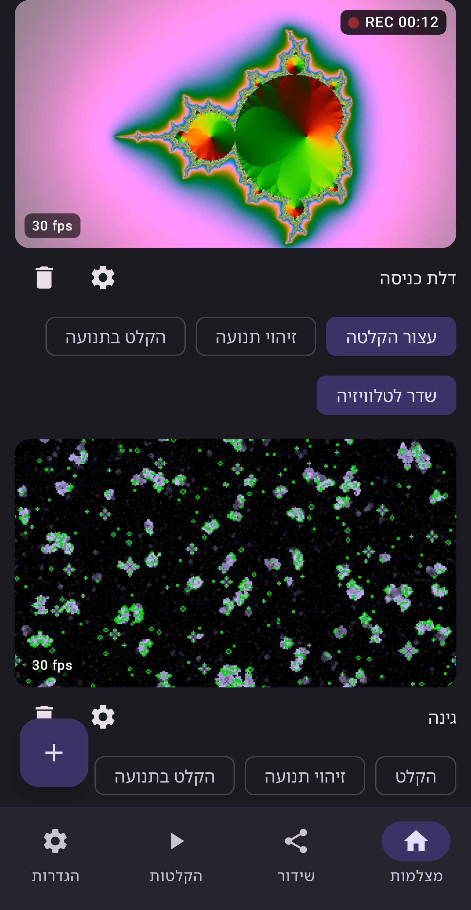
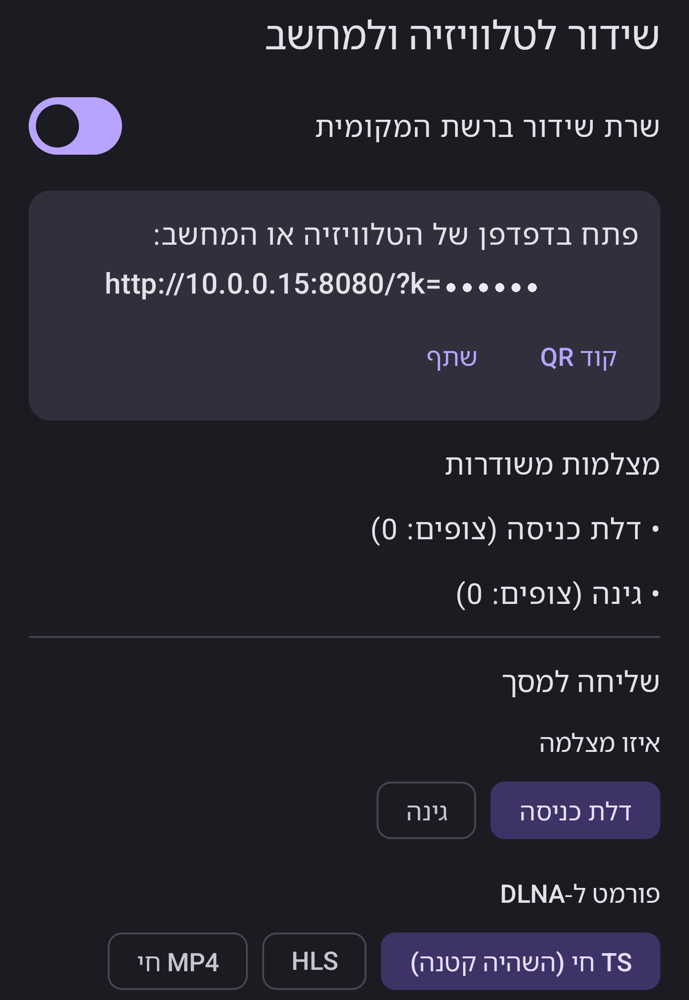
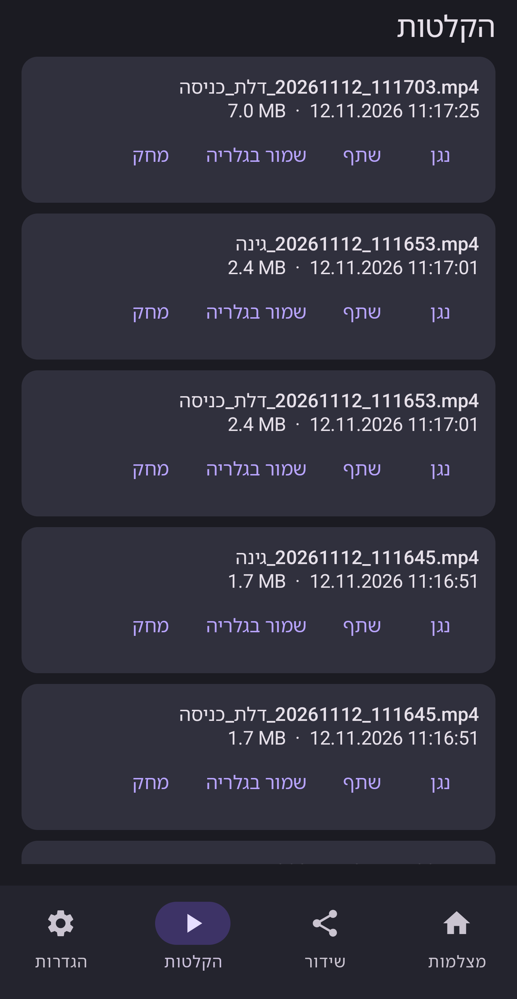
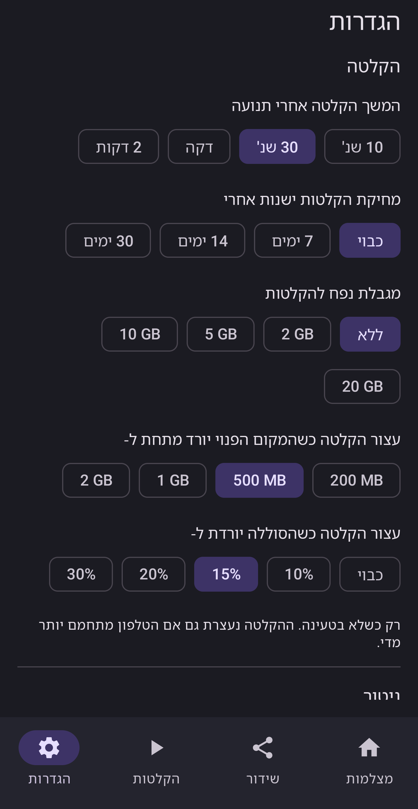

<div align="center">


  <a href="../../LICENSE"></a>
  
  
  <a href="https://github.com/DrummingBird1/camora/actions"></a>

<a href="../../README.md">English</a> · <a href="../../docs/readme/README.he.md">עברית</a> · <b>العربية</b> · <a href="../../docs/readme/README.ru.md">Русский</a> · <a href="../../docs/readme/README.es.md">Español</a> · <a href="../../docs/readme/README.fr.md">Français</a> · <a href="../../docs/readme/README.de.md">Deutsch</a> · <a href="../../docs/readme/README.pt.md">Português</a>

</div>

<div dir="rtl">

يحوّل Camora هاتف أندرويد إلى مركز فيديو صغير لكاميراتك: شاهد كاميرات IP وبطاقات التقاط HDMI، وسجّلها، واحصل على تنبيهات الحركة، واعرضها على أي شاشة في المنزل. بلا حساب ولا إعلانات ولا تتبع.

<p align="center">
  
  
  
  
</p>

## الميزات

| | | |
|---|---|---|
| 📷 | **كاميرات IP** | RTSP عبر TCP أو UDP، اكتشاف ONVIF، إعادة اتصال تلقائية. كلمات المرور مشفرة على الهاتف. |
| 🎮 | **بطاقات الالتقاط** | بطاقات التقاط HDMI عبر USB ‏(UVC) مع الصوت واختيار الوضع وقياس معدل الإطارات. |
| ⏺️ | **التسجيل** | MP4 مع الصوت، تسجيل عند الحركة، حذف حسب العمر أو المساحة، حفظ في المعرض. |
| 🔔 | **تنبيهات الحركة** | ثلاث درجات حساسية وإشعارات، ويستمر في المراقبة في الخلفية ومع إطفاء الشاشة. |
| 📺 | **على كل شاشة** | مشغّل متصفح بتأخير منخفض، ‏TS مباشر لتلفزيونات DLNA، ‏Chromecast، و-HLS لـ VLC. |
| ✨ | **الجودة** | حتى 4K، إعدادات جودة مسبقة، ‏H.264 أو H.265 لكل كاميرا. |
| 🔒 | **الخصوصية** | كل شيء يبقى على شبكتك. ‏HTTPS اختياري، والوصول عن بُعد فقط إن فعّلته. |
| 🌍 | **8 لغات** | الإنجليزية والعبرية والعربية والروسية والإسبانية والفرنسية والألمانية والبرتغالية. |

## 📥 الحصول على Camora

قريبًا على Google Play. حتى ذلك الحين يمكنك بناؤه من المصدر (أدناه).

**الموقع:** https://drummingbird1.github.io/camora/

## 📺 المشاهدة على شاشات أخرى

| أين | كيف |
|---|---|
| متصفح الكمبيوتر أو الهاتف | أقل تأخير (نحو نصف ثانية) |
| تلفزيونات Samsung وغيرها (DLNA) | TS مباشر، تأخير بضع ثوانٍ من التلفزيون |
| Chromecast / Google TV | HLS، تأخير بضع ثوانٍ من جهاز الاستقبال |
| VLC و-OBS ومشغلات أخرى | عنوان HLS أو TS مباشر |

## 🔧 المتطلبات

أندرويد 8.0 أو أحدث. تحتاج بطاقة الالتقاط إلى USB OTG. للتسجيلات الطويلة استخدم موزع USB-C مع الشحن.

## 🛠️ البناء من المصدر

تحتاج JDK 17 أو أحدث و-Android SDK 36.

</div>

```bash
git clone https://github.com/DrummingBird1/camora.git
cd camora
./gradlew assembleDebug
adb install -r app/build/outputs/apk/debug/app-debug.apk
```

<div dir="rtl">

## 📚 التوثيق

- [docs/ARCHITECTURE.md](../../docs/ARCHITECTURE.md): كيف ينتقل الفيديو من المصدر إلى التسجيلات والمشاهدين
- [docs/TESTING.md](../../docs/TESTING.md): الاختبار بلا أجهزة: كاميرات RTSP وهمية وأدوات قياس
- [docs/RELEASE.md](../../docs/RELEASE.md): التوقيع وإصدارات النشر
- [.github/CONTRIBUTING.md](../../.github/CONTRIBUTING.md): كيفية المساهمة

## 🔒 الخصوصية

لا حساب ولا إعلانات ولا تحليلات في Camora، ولا يرسل شيئًا إلى المطوّر إلا إذا اخترت "إرسال ملاحظات" بنفسك. [اقرأ سياسة الخصوصية](https://drummingbird1.github.io/camora/privacy.html)

## 💜 ادعم المشروع

Camora مجاني ومفتوح المصدر. إن كان مفيدًا لك يمكنك دعم تطويره:

<p align="center">
  <a href="https://github.com/sponsors/DrummingBird1"></a>
  <a href="https://www.patreon.com/c/Solvaris"></a>
  <a href="https://ko-fi.com/solvaris1"></a>
  <a href="https://buymeacoffee.com/solvaris"></a>
</p>

## 🤝 المساهمة

نرحب بتقارير الأخطاء والأفكار وطلبات الدمج. اقرأ CONTRIBUTING.md أولًا.

## 📄 الترخيص

Apache License 2.0. مكونات الطرف الثالث وتراخيصها مذكورة في التطبيق (الإعدادات، الأدوات، تراخيص المصادر المفتوحة).

</div>
