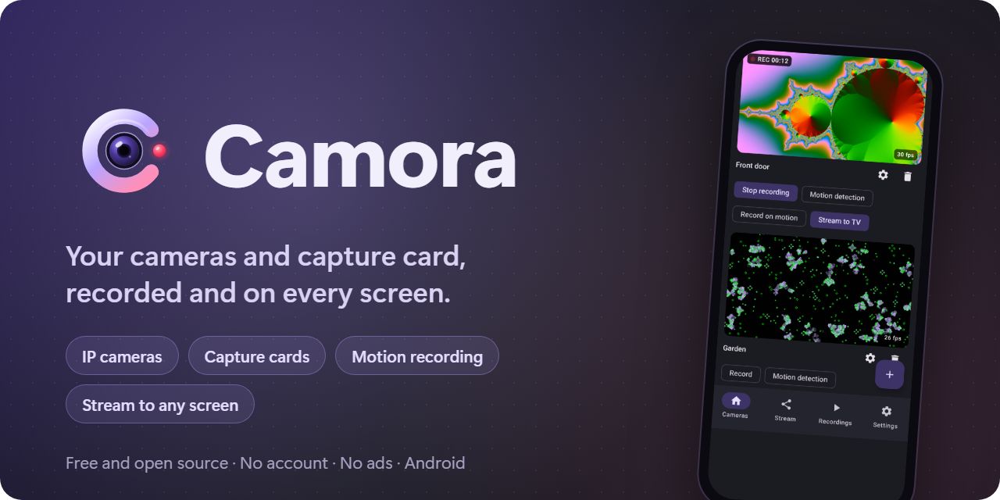
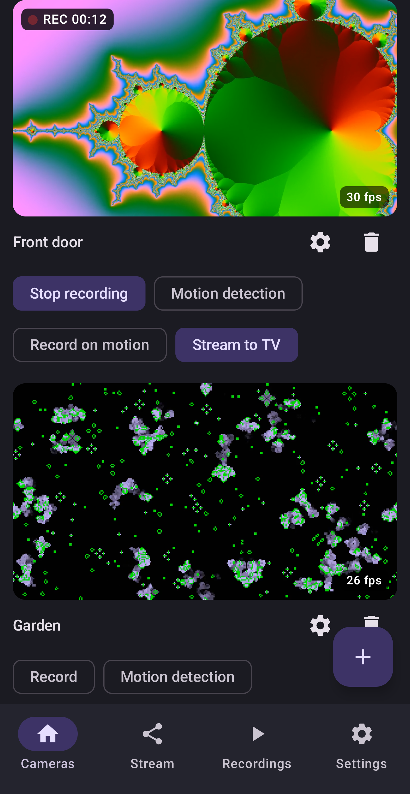
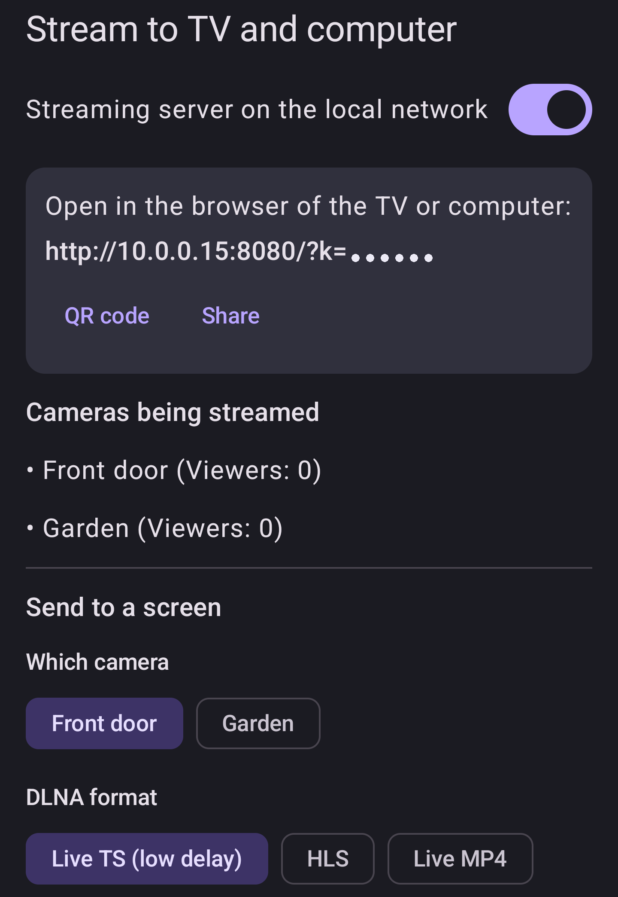
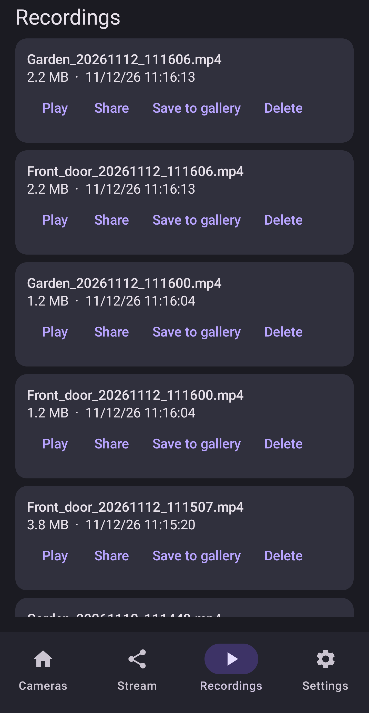
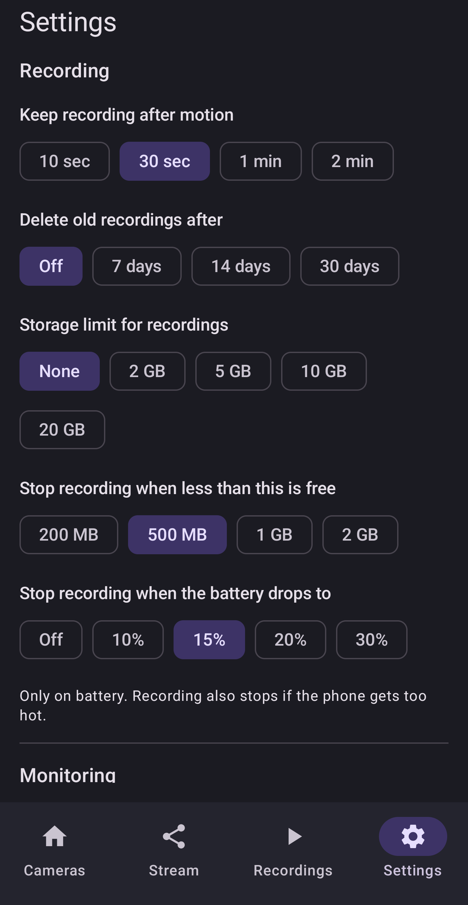

<div align="center">



  <a href="../../LICENSE"></a>
  
  
  <a href="https://github.com/DrummingBird1/camora/actions"></a>

<a href="../../README.md">English</a> · <a href="../../docs/readme/README.he.md">עברית</a> · <a href="../../docs/readme/README.ar.md">العربية</a> · <a href="../../docs/readme/README.ru.md">Русский</a> · <a href="../../docs/readme/README.es.md">Español</a> · <a href="../../docs/readme/README.fr.md">Français</a> · <b>Deutsch</b> · <a href="../../docs/readme/README.pt.md">Português</a>

</div>

Camora macht aus einem Android-Handy eine kleine Videozentrale für deine Kameras: IP-Kameras und HDMI-Capture-Karten ansehen, aufnehmen, bei Bewegung benachrichtigt werden und alles auf jeden Bildschirm im Haus bringen. Ohne Konto, ohne Werbung, ohne Tracking.

<p align="center">
  
  
  
  
</p>

## Funktionen

| | | |
|---|---|---|
| 📷 | **IP-Kameras** | RTSP über TCP oder UDP, ONVIF-Suche, automatische Wiederverbindung. Passwörter werden auf dem Handy verschlüsselt. |
| 🎮 | **Capture-Karten** | USB-HDMI-Capture-Karten (UVC) mit Ton, Moduswahl und gemessener Bildrate. |
| ⏺️ | **Aufnahme** | MP4 mit Ton, Aufnahme bei Bewegung, Aufräumen nach Alter oder Speicher, in die Galerie speichern. |
| 🔔 | **Bewegungsalarm** | Drei Empfindlichkeiten, Benachrichtigungen, läuft im Hintergrund und bei ausgeschaltetem Bildschirm. |
| 📺 | **Auf jedem Bildschirm** | Browser mit geringer Verzögerung, Live-TS für DLNA-Fernseher, Chromecast, HLS für VLC. |
| ✨ | **Qualität** | Bis 4K, Qualitätsstufen, H.264 oder H.265 pro Kamera. |
| 🔒 | **Privat** | Alles bleibt in deinem Netz. HTTPS optional, Fernzugriff nur wenn du ihn einschaltest. |
| 🌍 | **8 Sprachen** | Englisch, Hebräisch, Arabisch, Russisch, Spanisch, Französisch, Deutsch und Portugiesisch. |

## 📥 Camora holen

Bald bei Google Play. Bis dahin kannst du sie aus dem Quellcode bauen (unten).

**Website:** https://drummingbird1.github.io/camora/

## 📺 Auf anderen Bildschirmen ansehen

| Wo | Wie |
|---|---|
| Browser auf Computer oder Handy | Geringste Verzögerung (etwa eine halbe Sekunde) |
| Samsung- und andere DLNA-Fernseher | Live-TS, einige Sekunden Verzögerung durch den Fernseher |
| Chromecast / Google TV | HLS, einige Sekunden Verzögerung durch den Empfänger |
| VLC, OBS und andere Player | HLS- oder Live-TS-Adresse |

## 🔧 Voraussetzungen

Android 8.0 oder neuer. Eine Capture-Karte braucht USB OTG. Für lange Aufnahmen einen USB-C-Hub mit Ladefunktion nutzen.

## 🛠️ Aus dem Quellcode bauen

Du brauchst JDK 17+ und das Android SDK 36.

```bash
git clone https://github.com/DrummingBird1/camora.git
cd camora
./gradlew assembleDebug
adb install -r app/build/outputs/apk/debug/app-debug.apk
```

## 📚 Dokumentation

- [docs/ARCHITECTURE.md](../../docs/ARCHITECTURE.md): Wie das Video von der Quelle zu Aufnahmen und Zuschauern fließt
- [docs/TESTING.md](../../docs/TESTING.md): Testen ohne Hardware: simulierte RTSP-Kameras und Messwerkzeuge
- [docs/RELEASE.md](../../docs/RELEASE.md): Signieren und Release-Builds
- [.github/CONTRIBUTING.md](../../.github/CONTRIBUTING.md): Mitmachen

## 🔒 Datenschutz

Camora hat kein Konto, keine Werbung und keine Analyse und sendet nichts an den Entwickler, außer du wählst „Feedback senden“. [Datenschutzerklärung](https://drummingbird1.github.io/camora/privacy.html)

## 💜 Projekt unterstützen

Camora ist kostenlos und Open Source. Wenn sie dir hilft, kannst du die Entwicklung unterstützen:

<p align="center">
  <a href="https://github.com/sponsors/DrummingBird1"></a>
  <a href="https://www.patreon.com/c/Solvaris"></a>
  <a href="https://ko-fi.com/solvaris1"></a>
  <a href="https://buymeacoffee.com/solvaris"></a>
</p>

## 🤝 Mitmachen

Fehlerberichte, Ideen und Pull Requests sind willkommen. Bitte zuerst CONTRIBUTING.md lesen.

## 📄 Lizenz

Apache License 2.0. Fremdkomponenten und ihre Lizenzen stehen in der App (Einstellungen, Werkzeuge, Open-Source-Lizenzen).
