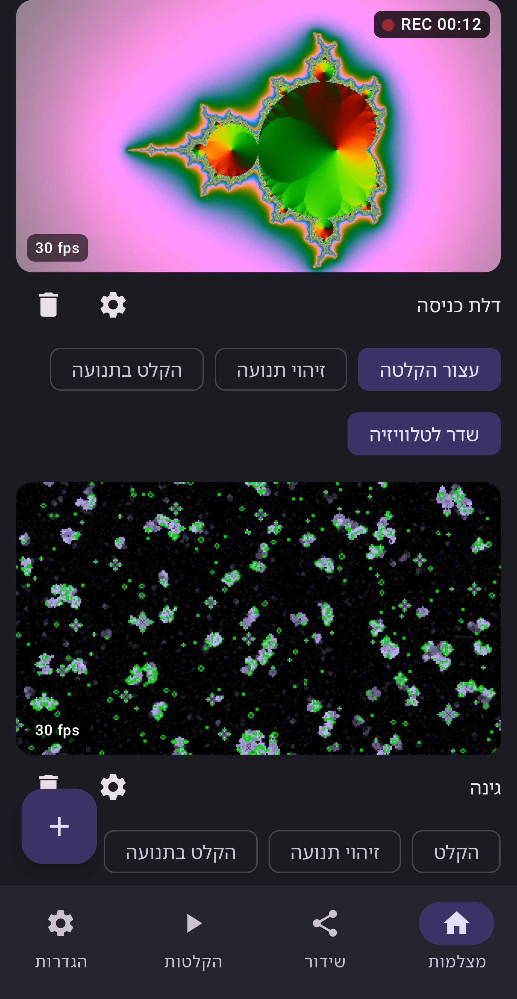
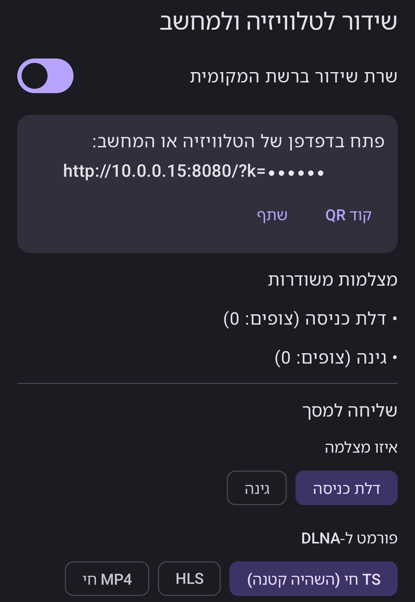
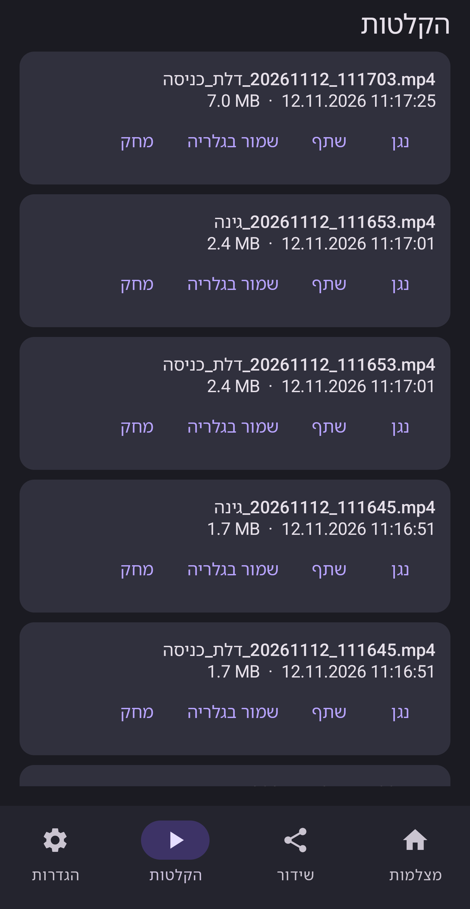
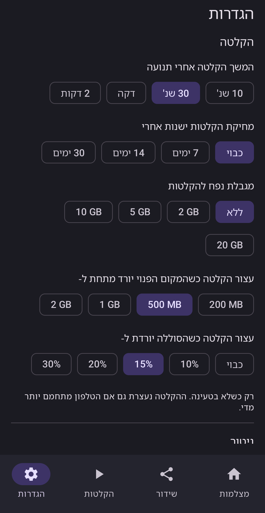

<div align="center">


  <a href="../../LICENSE"></a>
  
  
  <a href="https://github.com/DrummingBird1/camora/actions"></a>

<a href="../../README.md">English</a> · <b>עברית</b> · <a href="../../docs/readme/README.ar.md">العربية</a> · <a href="../../docs/readme/README.ru.md">Русский</a> · <a href="../../docs/readme/README.es.md">Español</a> · <a href="../../docs/readme/README.fr.md">Français</a> · <a href="../../docs/readme/README.de.md">Deutsch</a> · <a href="../../docs/readme/README.pt.md">Português</a>

</div>

<div dir="rtl">

Camora הופכת טלפון אנדרואיד למרכז וידאו קטן למצלמות שלך: צפייה במצלמות IP ובכרטיסי לכידה HDMI, הקלטה, התראות תנועה, ושידור לכל מסך בבית. בלי חשבון, בלי פרסומות ובלי מעקב.

<p align="center">
  
  
  
  
</p>

## יכולות

| | | |
|---|---|---|
| 📷 | **מצלמות IP** | RTSP ב-TCP או UDP, חיפוש ONVIF, התחברות מחדש אוטומטית. הסיסמאות מוצפנות בטלפון. |
| 🎮 | **כרטיסי לכידה** | כרטיסי HDMI ב-USB ‏(UVC) עם קול, בחירת מצב ומדידת קצב פריימים חיה. |
| ⏺️ | **הקלטה** | MP4 עם קול, הקלטה כשיש תנועה, מחיקה לפי גיל או נפח, שמירה בגלריה. |
| 🔔 | **התראות תנועה** | שלוש רמות רגישות, התראות, ממשיך לנטר ברקע וגם כשהמסך כבוי. |
| 📺 | **על כל מסך** | נגן דפדפן בהשהיה נמוכה, TS חי לטלוויזיות DLNA, ‏Chromecast, ‏HLS ל-VLC ולנגנים אחרים. |
| ✨ | **איכות** | עד 4K, רמות איכות, ‏H.264 או H.265 לכל מצלמה. |
| 🔒 | **פרטיות** | הכל נשאר ברשת שלך. ‏HTTPS לבחירה, וגישה מרחוק רק אם מפעילים אותה. |
| 🌍 | **8 שפות** | אנגלית, עברית, ערבית, רוסית, ספרדית, צרפתית, גרמנית ופורטוגזית. |

## 📥 הורדה

בקרוב ב-Google Play. עד אז אפשר לבנות מהקוד (למטה).

**אתר:** https://drummingbird1.github.io/camora/

## 📺 צפייה במסכים אחרים

| איפה | איך |
|---|---|
| דפדפן במחשב או בטלפון | ההשהיה הנמוכה ביותר (כחצי שנייה) |
| טלוויזיות Samsung ו-DLNA אחרות | TS חי, כמה שניות השהיה מצד הטלוויזיה |
| Chromecast / Google TV | HLS, כמה שניות השהיה מצד המקלט |
| VLC, ‏OBS ונגנים אחרים | כתובת HLS או TS חי |

## 🔧 דרישות

Android 8.0 ומעלה. כרטיס לכידה צריך USB OTG (מתאם או כרטיס עם USB-C). להקלטות ארוכות כדאי מפצל USB-C עם טעינה: כרטיס לכידה וקידוד רציף צורכים הרבה סוללה.

## 🛠️ בנייה מהקוד

צריך JDK 17 ומעלה ו-Android SDK 36.

</div>

```bash
git clone https://github.com/DrummingBird1/camora.git
cd camora
./gradlew assembleDebug
adb install -r app/build/outputs/apk/full/debug/app-full-debug.apk
```

<div dir="rtl">

## 📚 מסמכים

- [docs/ARCHITECTURE.md](../../docs/ARCHITECTURE.md): איך הווידאו זורם מהמקור להקלטות ולצופים
- [docs/TESTING.md](../../docs/TESTING.md): בדיקות בלי חומרה: מצלמות RTSP מדומות וכלי מדידה
- [docs/RELEASE.md](../../docs/RELEASE.md): חתימה וגרסאות הפצה
- [.github/CONTRIBUTING.md](../../.github/CONTRIBUTING.md): איך לתרום

## 🔒 פרטיות

ל-Camora אין חשבון, אין פרסומות ואין אנליטיקה, והיא לא שולחת שום דבר למפתח, אלא אם בוחרים בעצמכם "שליחת משוב". [למדיניות הפרטיות](https://drummingbird1.github.io/camora/he/privacy.html)

## 💜 תמיכה בפרויקט

Camora חינמית ובקוד פתוח. אם היא עוזרת לך, אפשר לתמוך בפיתוח:

<p align="center">
  <a href="https://github.com/sponsors/DrummingBird1"></a>
  <a href="https://www.patreon.com/c/Solvaris"></a>
  <a href="https://ko-fi.com/solvaris1"></a>
  <a href="https://buymeacoffee.com/solvaris"></a>
</p>

## 🤝 תרומה לקוד

דיווחי באגים, רעיונות ובקשות משיכה יתקבלו בשמחה. קודם כדאי לקרוא את CONTRIBUTING.md.

## 📄 רישיון

Apache License 2.0. הרכיבים של צד שלישי והרישיונות שלהם מופיעים באפליקציה (הגדרות, כלים, רישיונות קוד פתוח).

</div>
